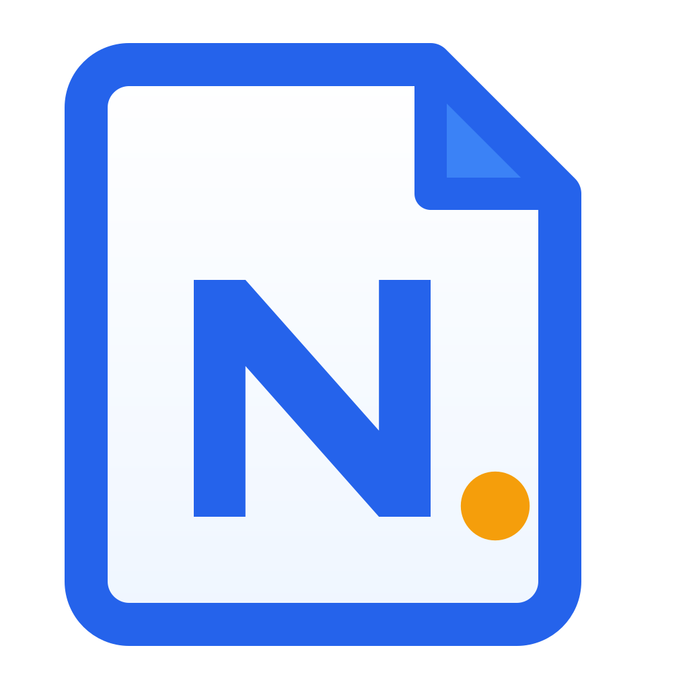
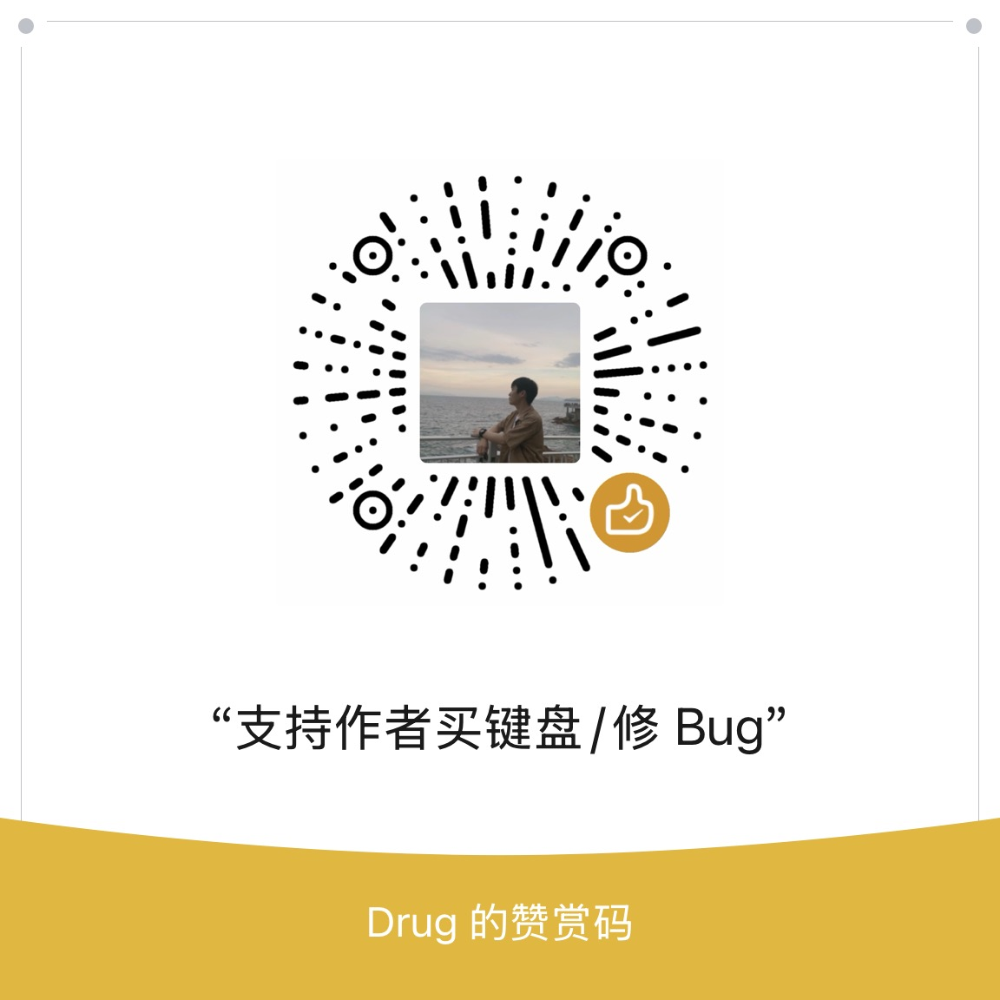

<div align="center">
  
  <h1>Nowen Note</h1>
  <p><strong>An open-source, self-hosted knowledge base, collaborative note app, and task workspace</strong></p>
  <p>
    Unified knowledge tree · Rich text / Markdown editors · AI knowledge Q&A · Real-time collaboration · Tasks and mind maps · Cross-platform clients
  </p>
  <p>
    <a href="./README.md">简体中文</a> ·
    <a href="https://nowen.cn/">Official Website</a> ·
    <a href="https://nowen.cn/#/note/download">Download Center</a> ·
    <a href="https://nowen.cn/#/note/tutorials">Help Center</a> ·
    <a href="http://note.nowen.cn/">Live Demo</a> ·
    <a href="https://github.com/cropflre/nowen-note/releases">Downloads</a> ·
    <a href="./docs/tutorials/README.md">Tutorials</a> ·
    <a href="./docs/tutorials/mcp.en.md">MCP Installation</a> ·
    <a href="./.agents/skills/nowen-note-development/SKILL.md">AI Development Skill</a> ·
    <a href="./CHANGELOG.md">Changelog</a>
  </p>
</div>

<div align="center">

[](https://github.com/cropflre/nowen-note/releases)
[](https://hub.docker.com/r/cropflre/nowen-note)
[](./LICENSE)
[](https://nodejs.org/)
[](./docker-compose.yml)

</div>

> Nowen Note is more than an editor. It is designed as user-controlled knowledge infrastructure that can run long-term on a NAS or server and remain accessible from the web, desktop, and mobile clients.

> **Remote NAS connection and sign-in:** Nowen Note supports deployment on **UGREEN NAS (UGOS / UGOS Pro)** and **Feiniu NAS (fnOS)**. After deployment, connect and sign in from the web, desktop, or Android client using a LAN IP address, an IPv6 address, or a public domain secured with HTTPS.

## v1.5.2 highlights · 2026-10-16

**The v1.5.2 code is merged into `main`.** This update focuses on the **file center, AI/MCP integrations, task workflows, reliable sync, and release tooling**. Downloadable builds and supported platforms depend on what is publicly available in [GitHub Releases](https://github.com/cropflre/nowen-note/releases).

> [!IMPORTANT]
> Create a full backup and verify persistent database and attachment storage before upgrading, especially on Docker and NAS installations. **Rolling back an app or container image does not roll back your data.**

- **File center:** Explorer-style folders, masonry view, tags, smart folders, upload progress, batch rename, recycle-bin recovery, personal folder synchronization, and existing-file reuse. AI-assisted metadata organization requires review and confirmation; semantic search works over metadata, with explicit platform and permission limits.
- **Expanded MCP:** Permission-scoped knowledge-tree and personal task/project workflows, safe file organization, task-to-note snapshots, and preview-confirm writes with revision checks. Includes a native MCP connection dashboard and optional authenticated loopback-only Streamable HTTP transport.
- **Tasks:** Confirmed AI task generation, today's completed-task summary, task-tree archiving, save-task-details-as-note without deleting the task, and Excel/Markdown exports.
- **Sync and editing:** Per-note sync receipts, personal folder structure reconciliation and recovery, plain-text notes, Chinese typography actions, and restored reading positions.
- **Release and deployment:** Release center, artifact verification, optional Caddy HTTPS configuration, and isolated AppX packaging / update handling for Microsoft Store. **Store integration does not mean the app is already listed in the Store.**

See the [full changelog](./CHANGELOG.md), [download center](https://nowen.cn/#/note/download), and [GitHub Releases](https://github.com/cropflre/nowen-note/releases).

## Connect AI clients to Nowen Note

The Nowen Note MCP Server connects to Claude Code, Cursor, VS Code, and other compatible clients. It exposes notes, scoped knowledge-tree resources, personal tasks/projects, personal file management, and personal automations **within Personal API Token permissions**. Sensitive mutations require explicit authorization, preview/confirmation, and concurrency revision checks; dangerous capabilities are disabled by default.

- [MCP Server installation guide](./docs/tutorials/mcp.en.md)
- [中文安装教程](./docs/tutorials/mcp.md)
- [Standalone nowen-mcp package README](./packages/nowen-mcp/README.md)

The supported source-build launcher uses Node.js 20+ and `packages/nowen-mcp/bin/nowen-mcp.mjs`. Do not point clients directly to the internal `dist/scoped-entry.js`. The normal transport is stdio; v1.5.2 also introduces **explicitly enabled, authenticated, loopback-only Streamable HTTP**. Create a separate least-privilege token for each client; never embed administrator passwords in MCP configurations.

## Why Nowen Note

| | |
| --- | --- |
| **You own the data** | Self-host with Docker or deploy on NAS platforms such as UGREEN UGOS and Feiniu fnOS. Databases, attachments, and backups stay under your control. Attachments can use S3, Cloudflare R2, or MinIO, while backups can be sent through email or WebDAV. |
| **One tree for every document** | Mix folders, rich-text notes, and Markdown notes in one hierarchy. Create documents at the root, drag and sort nodes, import files, expand or collapse the tree, inherit permissions, protect folders with passwords, and publish shared content. |
| **Switch editing formats per note** | Convert notes between rich text and Markdown while preserving major structure, code blocks, and links. Use either format for quick notes, technical documentation, or long-form writing. |
| **Built for individuals and teams** | Tags, tasks, AI, workspaces, notebook permissions, real-time collaboration, public sharing, and guest comments live in one system. |

## Core capabilities

| Module | Current capabilities |
| --- | --- |
| **Unified knowledge tree** | Mixed folders, rich-text notes, and Markdown notes; root-level documents, unlimited nesting, drag sorting, drag-to-change hierarchy, a unified create menu, expand/collapse all, Markdown drag-and-drop or file import, filtering, search, note counts, trash, shared tree views, and three-column browsing with child-folder scope. |
| **Folder security and access control** | Folder passwords, short-lived unlock tokens, directory ACLs, Restricted mode, explicit allow/deny rules, inherited policy evaluation, and protected import/export flows. |
| **Rich text and Markdown** | Tiptap 3, CodeMirror 6, per-note rich-text/Markdown conversion, plain-text notes, live and split preview, outlines, formatting tools, tables, code blocks, KaTeX, Mermaid, footnotes, Callouts, media embeds, Chinese typography, reading-position restoration, comments, and version history. |
| **Long documents and editor stability** | Complexity detection, Worker analysis, viewport rendering, windowed editing, incremental saves, large-document safe modes, outline navigation, and recovery logic for hidden Markdown markers and cursor state. |
| **Performance and delivery** | Lazy-loaded workspace, editor, task, journal, file, AI, and sharing surfaces; cache validators, Gzip/Brotli precompression, and bundle-budget checks reduce startup and repeated transfer cost. |
| **Image editing** | Crop images and add text, freehand drawing, arrows, shapes, and mosaic effects. Existing remote images can be migrated into local attachments or object storage. |
| **Knowledge organization and search** | Colored tags, favorites, pinning, full-text search, current-directory note search, improved in-document find and replace, backlinks, block references, reverse links, and a knowledge graph. Permission-aware search hides restricted resources before result limits are applied. |
| **AI** | OpenAI-compatible APIs, Qwen, Gemini, DeepSeek, Doubao, and Ollama. Features include continuation, rewriting, translation, title and tag generation, summaries, embeddings, and RAG knowledge Q&A. It also supports task progress queries and confirmed creation/completion of personal tasks. |
| **Tasks and visualization** | Hierarchical tasks, lists, Kanban, calendar, Gantt/timeline, dependencies, recurrence, reminders, templates, My Day, Inbox, offline tasks/habits, Android reminders, and mind maps. v1.5.2 adds confirmed AI task generation, daily completion summaries, task-tree archiving, task details saved as a separate note, Excel/Markdown exports, plus due-date sorting and webhook digests. |
| **Collaboration, permissions, and sharing** | Yjs + WebSocket collaboration, workspaces and roles, directory ACLs, Restricted access, explicit allow/deny policies, ownership transfer, centralized share management, passwords and expiration, guest comments, public knowledge spaces, and rich-text/Markdown inline comments. |
| **Sync and edit protection** | Incremental sync, per-note server acknowledgements, persistence receipts, draft recovery, serial saves, revision checks, and offline workspace support. Personal folder-structure sync and recoverable trash flows improve consistency, while invalid cached attachment blobs are quarantined and repaired. |
| **Import, export, and migration** | Import Markdown, Word/DOCX, web URLs, WeChat articles, SingleFile HTML, SiYuan ZIP archives, Obsidian, Xiaomi Notes, and other supported sources. Export Markdown, PDF, Word, images, or full ZIP packages with permission mapping, conflict preview, reports, controlled rollback, image access preparation, and footnote handling. Team single-note ZIP export resolves the note's real workspace scope. |
| **Attachments and storage** | Explorer-style file-center navigation, masonry view, folders, tags, smart folders, upload progress, scoped moves/renames, recoverable trash, personal attachment-folder synchronization, inserting existing files, and progress-tracked external-image migration. [AI-assisted organization and semantic search](./docs/user/file-ai-organization.md) use file metadata, preview-confirmation and access checks rather than file bytes, with platform limitations. Storage backends include local disk, S3, R2, and MinIO. See [organization](./docs/user/file-asset-organization.md), [recycle bin](./docs/user/file-recycle-bin.md), and [folder sync](./docs/user/file-folder-sync.md). |
| **Accounts and security** | Multiple-account history, remembered accounts, auto-login, remote server connections, session validation and revocation, 2FA, scoped Personal API Tokens, audit logs, protected attachment access, and concealment of restricted-resource existence. |
| **Backups, automation, and developer APIs** | Full and scheduled local backups, ZIP verification, email and encrypted WebDAV backups, managed Docker update checks, webhooks, signed/scoped plugins, OpenAPI, TypeScript SDK, CLI, and browser clipper. The [MCP Server](./docs/tutorials/mcp.en.md) supports permission-scoped notes, knowledge-tree, personal task/project and file tools plus opt-in local HTTP transport; sensitive changes require explicit preview-confirm flows. |
| **Cross-platform access** | Web, Electron for Windows/macOS/Linux, Android, iOS project, HarmonyOS project, and Docker/NAS deployment. UGREEN UGOS and Feiniu fnOS are supported, and clients can connect through IPv4, IPv6, or a domain name. Android includes in-app gesture image preview and native task notifications. |

## Previous release · v1.5.1

v1.5.1 improved **task reminders and digests, AI-driven task actions, Android sync and sign-in, rich-text editing, and encrypted-content safeguards**. See the [v1.5.1 release notes](https://github.com/cropflre/nowen-note/releases/tag/v1.5.1), or the [changelog](./CHANGELOG.md) for earlier versions.

## Screenshots

### Desktop

| AI writing assistant | AI provider settings |
| :---: | :---: |
|  |  |

### Mobile

| Sidebar | Note list | Editor |
| :---: | :---: | :---: |
|  |  |  |

## Website and demo

- Official website: <https://nowen.cn/>
- Nowen Note product overview: <https://nowen.cn/#/note>
- Multi-platform download center: <https://nowen.cn/#/note/download>
- Documentation and help center: <https://nowen.cn/#/note/tutorials>
- Demo: <http://note.nowen.cn/>
- Username: `demo`
- Password: `demo123456`

> The demo is reset periodically. Do not store private or important data in it.

## Quick deployment

### Docker Compose (recommended)

Docker Engine and Docker Compose v2 are required.

```bash
git clone https://github.com/cropflre/nowen-note.git
cd nowen-note
docker compose up -d
```

Open `http://<server-ip>:3001`.

Default administrator account:

```text
Username: admin
Password: admin123
```

> Change the default password immediately. Public deployments should also use HTTPS, backups, a correct public origin, and restricted CORS settings.

### HTTPS deployment (optional)

Reuse an existing Nginx, Lucky, or NAS reverse proxy if available. For a new deployment, the companion Caddy template automatically obtains and renews certificates. It requires Docker Compose **2.24.4+**, a correctly resolved public domain, and reachable ports 80/443.

Set `NOWEN_DOMAIN=note.example.com` in `.env`, then run:

```bash
docker compose -f docker-compose.yml -f docker-compose.https.yml config --quiet
docker compose -f docker-compose.yml -f docker-compose.https.yml up -d
```

Open `https://note.example.com`. The template removes the application's host port 3001 mapping, sets the public share origin, and persists Caddy certificates. Keep specifying both files for subsequent management commands.

For an existing instance, retain its Compose project name and data mounts, back up before switching, and reconnect clients using the domain once HTTPS is ready. See [HTTPS deployment and acceptance](./docs/https-deployment.md) for prerequisites, existing-proxy examples, and verification steps.

### UGREEN NAS / Feiniu NAS remote connection and sign-in

Nowen Note can be deployed on **UGREEN NAS (UGOS / UGOS Pro)** and **Feiniu NAS (fnOS)**. Use the corresponding `.upk` or `.fpk` package from Releases, or deploy with Docker Compose.

After the service starts:

- **LAN access:** Open `http://<nas-lan-ip>:3001` in a browser.
- **Remote access:** Enter the NAS public domain, IPv4 address, or IPv6 service address in the web, desktop, or Android client, then sign in.
- **Public deployment:** Configure an HTTPS reverse proxy. Do not expose an unencrypted HTTP service directly to the internet.

See available packages in [GitHub Releases](https://github.com/cropflre/nowen-note/releases).

Check status and logs:

```bash
docker compose ps
docker compose logs -f --tail=200 nowen-note
```

### Upgrade from an earlier release

Create a full backup first and confirm that both the database and attachment directory are persisted.

```bash
docker compose pull
docker compose up -d
```

To pin a Docker image, first verify the tag in [Docker Hub](https://hub.docker.com/r/cropflre/nowen-note/tags). The following example uses the publicly available v1.5.1 tag; replace it only once the v1.5.2 image is published:

```bash
NOWEN_IMAGE_TAG=v1.5.1 docker compose pull
NOWEN_IMAGE_TAG=v1.5.1 docker compose up -d
```

> [!IMPORTANT]
> **Before upgrading, create a full backup and verify persistent database and attachment storage.** Docker / NAS users should keep an independent backup; image rollback does not restore the database. See the [changelog](./CHANGELOG.md) and [public releases](https://github.com/cropflre/nowen-note/releases).

### Managed Docker updates (optional)

Managed updates only support the official [`docker-compose.yml`](./docker-compose.yml) and are disabled by default. The main application container does not mount the Docker socket; a separate restricted updater container performs the update.

```bash
cp .env.example .env
printf '\nNOWEN_UPDATER_TOKEN=%s\n' "$(openssl rand -hex 32)" >> .env
NOWEN_IMAGE_TAG=v1.5.1 docker compose --profile updater up -d
```

Administrators can then run preflight checks, create a full backup, update, verify health, and roll back the image from Settings → About → Version.

> Rolling back an image does not roll back the database. Keep independent production backups.

See [Docker online update and recovery](./docs/docker-online-update.md).

### Run only the main container

```bash
docker run -d \
  --name nowen-note \
  --restart unless-stopped \
  -p 3001:3001 \
  -e TZ=Asia/Shanghai \
  -v /opt/nowen-note/data:/app/data \
  cropflre/nowen-note:v1.5.1
```

## Data, backups, and configuration

### Persistent directory

The persistent directory inside the container is **`/app/data`**, not `/data`. The default Compose file uses the `nowen-note-data` Docker volume.

```text
/app/data/
├── nowen-note.db
├── attachments/
├── backups/
├── fonts/
└── .jwt_secret
```

- SQLite is the default production database at `/app/data/nowen-note.db`.
- Attachments are stored under `/app/data/attachments` and organized by `YYYY/MM`.
- Automatic backups are stored under `/app/data/backups` by default.
- Map `BACKUP_DIR` to an independent physical disk and follow a 3-2-1 backup strategy for production.
- Third-party image-host uploads are retired. New images use the attachment system; historical remote images can be migrated.
- PostgreSQL adaptation and migration are still under validation. Production deployment and recovery remain based on SQLite.

### Common environment variables

See [`.env.example`](./.env.example) for the complete template.

| Variable | Default | Purpose |
| --- | --- | --- |
| `NOWEN_PORT` | `3001` | Exposed Compose port |
| `NOWEN_DOMAIN` | empty | Public hostname used by the optional Caddy HTTPS template |
| `TZ` | `Asia/Shanghai` | Container timezone |
| `PUBLIC_WEB_ORIGIN` | empty | Public or reverse-proxy origin used to generate share links |
| `FILE_PUBLIC_ORIGIN` | inherits `PUBLIC_WEB_ORIGIN` | Optional public origin used when copying File Manager / image-host direct links; uploads, previews, and owner downloads keep using the current server connection |
| `JWT_SECRET` | generated and persisted | Session signing and fallback encryption; must match across instances |
| `BACKUP_DIR` | `/app/data/backups` | Automatic backup directory |
| `BACKUP_WEBDAV_ENCRYPTION_KEY` | falls back to `JWT_SECRET` | Encrypts stored WebDAV credentials; use a dedicated production key |
| `CORS_ORIGINS` | native client origins | Additional comma-separated web origins |
| `MAX_ATTACHMENT_SIZE_MB` | `100` | Maximum attachment size |
| `ATTACHMENT_STORAGE` | `local` | Set to `s3` for S3/R2/MinIO |
| `CALENDAR_EXPORT_ENCRYPTION_KEY` | empty | Encrypts calendar S3 export credentials |
| `NOWEN_UPDATER_TOKEN` | empty | Enables the managed Docker updater |

- [Object storage](./docs/object-storage.md)
- [WebDAV backup](./docs/webdav-backup.md)
- [Email backup](./docs/backup-email-smtp.md)

## Client and platform status

| Platform | Distribution / build | Status |
| --- | --- | --- |
| **Web / Docker** | Docker Hub or source build | Recommended deployment; supports `amd64`, `arm64`, or multi-architecture images |
| **Windows / macOS / Linux** | [GitHub Releases](https://github.com/cropflre/nowen-note/releases) or `npm run electron:build` | Electron client can connect to a remote service or use the local backend |
| **Android** | Release APK or Capacitor build under `frontend/` | Actively maintained; system share import, Markdown file import, immersive editing, mobile knowledge tree, gesture image preview, native task reminders, and remote NAS service sign-in |
| **iOS** | Capacitor project and GitHub Actions/TestFlight flow | Requires Apple signing and a developer account; see [iOS release guide](./docs/iOS-Release.md) |
| **HarmonyOS** | Open [`nowen-harmony/`](./nowen-harmony/) in DevEco Studio | ArkTS + ArkWeb MVP; some native capabilities are still being completed |
| **fnOS** | `.fpk` in Releases | Supports Feiniu NAS installation. The current package primarily targets x86_64; after deployment, connect and sign in using a LAN or public service address. |
| **UGREEN UGOS** | `.upk` in Releases or build scripts | Supports UGREEN NAS installation, depending on device architecture and app installation support; after deployment, connect and sign in using a LAN or public service address. |
| **Other NAS** | Docker Compose | Synology, QNAP, ZSpace, and similar devices can use the Docker deployment |

> Available packages vary by release. Check [GitHub Releases](https://github.com/cropflre/nowen-note/releases).

## Local development

Requires Node.js 20+, npm, and Git. Electron and native builds also require platform toolchains.

```bash
git clone https://github.com/cropflre/nowen-note.git
cd nowen-note
npm install
npm run install:all
```

Start two terminals:

```bash
npm run dev:backend
```

```bash
npm run dev:frontend
```

Open `http://localhost:5173`.

Common commands:

```bash
npm run build:all
npm run electron:dev
npm run electron:build
(cd backend && npm test)
(cd frontend && npm run test:run)
```

Android:

```bash
cd frontend
npm run cap:build
npx cap open android
```

> Capacitor 8 requires Node.js 22+ for Android release tooling. Regular web and Electron development can continue to use the project's Node.js 20+ baseline.

iOS:

```bash
npm run cap:sync:ios
npm run cap:open:ios
```

## Technology stack

| Layer | Main technologies |
| --- | --- |
| **Frontend** | React 18, TypeScript, Vite 5, Tailwind CSS, Tiptap 3, CodeMirror 6, Yjs, IndexedDB |
| **Backend** | Node.js 20, Hono 4, WebSocket, better-sqlite3, FTS5, sqlite-vec, sharp |
| **Desktop** | Electron 33, electron-builder, electron-updater |
| **Mobile** | Capacitor 8 for Android/iOS, ArkTS + ArkWeb for HarmonyOS |
| **Storage and backup** | SQLite, local attachments, S3/Cloudflare R2/MinIO, email and WebDAV backups; PostgreSQL is under validation |
| **Developer APIs** | OpenAPI 3.0, TypeScript SDK, CLI, MCP Server, Webhook |

## Repository layout

```text
nowen-note/
├── frontend/       # React web app and Capacitor clients
├── backend/        # Hono APIs, database, sync, and background tasks
├── electron/       # Electron main process and packaging
├── packages/       # SDK, CLI, MCP, and developer packages
├── nowen-harmony/  # HarmonyOS ArkTS / ArkWeb client
├── docs/           # Deployment, tutorials, and design documents
└── scripts/        # Build, migration, packaging, and release scripts
```

## AI Skills for users and contributors

This repository provides two distinct [Agent Skills](./.agents/skills/). **A Skill is guidance for an AI assistant, not an authenticated connection to your server; it contains no private notes or API credentials.**

- **[nowen-note-development](./.agents/skills/nowen-note-development/SKILL.md)**: for maintainers and coding agents working on the Nowen Note repository. Covers product decisions, the codebase map, Issue/PR triage, UX principles, sync/security/backups, testing and delivery criteria.
- **[nowen-note](./.agents/skills/nowen-note/SKILL.md)**: for people who want AI to search, read, create and organize their own notes using authorized MCP tools or an already configured CLI.

Matching copies are available under [`.claude/skills/`](./.claude/skills/) for clients that use that layout. Copy the relevant Skill to the directory supported by your AI client, or ask the agent to read the appropriate `SKILL.md`. **Automatic Skill discovery is client-dependent.**

To **actually access a personal knowledge base**, follow the [MCP setup guide](./docs/tutorials/mcp.en.md) and grant a restricted Personal API Token. Installing a Skill alone does not grant access to your notes.

Example prompt: "Read the nowen-note-development Skill first, inspect the code behind this Issue, implement the smallest safe fix, and report the tests you ran."

## Documentation

- [Nowen official website](https://nowen.cn/)
- [Nowen download center](https://nowen.cn/#/note/download)
- [Nowen official help center](https://nowen.cn/#/note/tutorials)
- [MCP Server installation and usage](./docs/tutorials/mcp.en.md)
- [MCP Server 中文安装教程](./docs/tutorials/mcp.md)
- [Tutorial center](./docs/tutorials/README.md)
- [Feature overview](https://nowen.cn/#/note/features)
- [Installation and troubleshooting](https://nowen.cn/#/note/faq)
- [API documentation](https://nowen.cn/#/note/api)
- [Deployment guide](./docs/deployment.md)
- [Docker update and recovery](./docs/docker-online-update.md)
- [WebDAV backup](./docs/webdav-backup.md)
- [Object storage](./docs/object-storage.md)
- [Email backup](./docs/backup-email-smtp.md)
- [ARM64 deployment](./docs/deploy-arm64.md)
- [iOS release guide](./docs/iOS-Release.md)
- [GitHub desktop asset collection and release verification](./docs/releases/github-release-assets.md)
- [Privacy policy](./docs/PRIVACY.md)
- [Browser clipper](https://chromewebstore.google.com/detail/nowen-note-web-clipper/nglkodhfdbnfielchjpkjhenfaecafpg)
- OpenAPI is available at `/api/openapi.json` after startup.

## Current boundaries

- **Database:** SQLite is the fully supported production default. PostgreSQL adapters, schemas, and partial dual-database tests exist, but production switching is not yet enabled.
- **Format conversion:** Rich-text/Markdown conversion preserves major structures where possible. Highly customized HTML, complex extension nodes, or third-party syntax may still require manual review.
- **WebDAV:** Used for completed backup files, not real-time sync, live database storage, or attachment hosting. Remote retention must be managed separately.
- **Managed Docker updates:** Only support the official managed Compose deployment.
- **Third-party image hosting:** Upload integration is retired; only historical configuration cleanup and image migration remain.
- **macOS:** Unsigned or unnotarized packages may require removing quarantine attributes; see the desktop tutorial.
- **Mobile:** Android has the most complete maintenance coverage. iOS and HarmonyOS distribution, signing, and some native bridges remain platform-dependent.

## Releases

The README documents stable capabilities, recent highlights, and deployment. Complete commit-level history remains in the changelog.

- [Latest release](https://github.com/cropflre/nowen-note/releases)
- [Full changelog](./CHANGELOG.md)
- [Issues and roadmap](https://github.com/cropflre/nowen-note/issues)

## Contributing

Issues, feature suggestions, and pull requests are welcome. Before submitting code, run at least:

```bash
npm run build:all
(cd backend && npm test)
(cd frontend && npm run test:run)
```

Feedback channels:

- [GitHub Issues](https://github.com/cropflre/nowen-note/issues)
- QQ group: `1093473044`

## Support the project

If Nowen Note helps you, sponsorship supports continued maintenance and development.

<table align="center">
  <tr>
    <th>WeChat</th>
    <th>Alipay</th>
  </tr>
  <tr>
    <td align="center"></td>
    <td align="center"></td>
  </tr>
</table>

Read the [author's note](./AUTHOR_STORY.md).

## License

Nowen Note is licensed under the [GNU General Public License v3.0](./LICENSE).

<!-- CHANGELOG:BEGIN -->
<!-- Detailed release history lives in CHANGELOG.md. Keep the README focused on stable capabilities and recent highlights. -->
<!-- CHANGELOG:END -->
