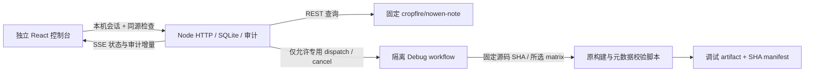

> 2026-10-25：新增统一 Actions 构建、触发脚本与页面、独立发布工作流。当前范围、配置及未验收边界见 [新版说明](../../tools/release-center/CLOUD-RELEASE.md)。以下为历史设计和验收记录。

# Nowen Release Center：审计与 Phase 1 设计

> Phase 2B 已编写既有正式构建接管、完整桌面复核、Draft/审批/发布源码；写操作默认关闭，运行测试按要求延后，独立正式构建编排仍待实现。见 [Phase 2B 范围与风险](../qa/v1.5.2/release-center-phase2b.md)。下文为各阶段历史审计，不代表新增流程验收通过。

> Phase 3 渠道追踪与交接适配已接入，并完成隔离供应商夹具的单元/API、浏览器和生产构建回归；范围、证据与未验证项见 [Phase 3 实现记录](../qa/v1.5.2/release-center-phase3.md)。正式发布和渠道自动上传仍未实现，未进行真实平台联调。

> 后续实现进展见文末 Phase 2A 补充和 [真实三平台调试验收](../qa/v1.5.2/release-center-remote-debug.md)；[Phase 2A 本地记录](../qa/v1.5.2/release-center-artifact-review.md)保留历史状态。

## 2026-10-30：v1.5.4 正式发版职责（当前）
 
 本节为当前流程准则；下方 Phase 1/2A/2B 设计表格是历史审计，不代表 v1.5.4 仍沿用旧发布路径。

| 工作流/入口 | 当前职责 | 是否能正式发布 |
| --- | --- | --- |
| `scripts/release.sh` | 调用 `release-cloud.mjs`，将固定分支 SHA、版本、目标派发到统一构建或发布工作流；本机不构建、不推 Tag、不上传二进制 | 否，属于安全编排入口 |
| `release-build.yml` | 手动构建；验证精确 commit/version/targets，生成各平台候选 artifact、manifest 和校验数据 | 否，不创建 Tag、GitHub Release 或 Docker registry tag |
| `release-publish.yml` | 重新核对成功构建 Run ID/attempt、commit SHA、版本确认和目标 channels；经过 `release-github` / `release-docker` / `release-testflight` 环境审批 | **是，唯一正式发布工作流** |
| `release.yml` | 手动桌面调试构建；electron-builder 固定 `--publish never`。旧 `release-assets` Draft 收集仅在显式设置 `NOWEN_LEGACY_RELEASE_ASSETS_ENABLED=1` 时开放 | 默认否；不是 v1.5.4 正式路径 |
| `publish.yml` | main 上的旧一键发布器已由 fail-closed 兼容入口替代 | 否 |
| `ios-release.yml` | reusable/manual iOS 签名与 IPA 构建，只输出 artifact；TestFlight 上传归统一发布工作流 | 否 |
| `microsoft-store-appx.yml` | 独立 AppX 候选打包和 manifest 校验 | 否，不自动提交 Partner Center |
| `sync-gitee-release.yml` | GitHub Release 已正式发布后镜像允许的小文件 | 否，发布后的异步镜像 |

**唯一正式路径：** `release-build.yml` → 人工复核候选产物 → `release-publish.yml`。不得用 Tag push、旧 `publish.yml`、旧 `release-assets` 或本地 legacy 脚本绕过该路径。v1.5.4 冻结期间不触发任何发布工作流。

日期：2026-10-16；开发基线：`release/v1.5.2`。首次审计 HEAD `a0f65787`；期间用户其他工作推进到 `7dcc450a`，本工具不修改、暂存或回退这些工作。任务源码取远端分支的固定完整 SHA，不使用当前工作区替代候选提交。新需求，没有需要编造的历史故障根因；目标是消除手工发布时对工作流、副作用和资产状态的判断负担。

## 真实发布职责

| 入口 | 触发与资产 | 副作用与边界 |
| --- | --- | --- |
| `scripts/release.sh` | 包装 legacy 发布入口，Node 堆内存与原生/Android 工具链基线；Draft 编排 | 真实发布会清理指定旧构建目录；dispatch 同 Tag 的 GitHub 汇总/校验任务，本地只核对回执和当前资产清单，通过后可将 Draft 转为正式；[新流程与启用边界](../releases/github-release-assets.md) |
| `scripts/release-legacy.sh` | 约 2,900 行；Docker、PC、Android、Lite、FPK/UPK 等组合 | 可 fetch/rebase/merge、改写版本、commit、push HEAD/Tag、Docker push、创建 Release；已有 Release 可 `upload --clobber`。`--build-only` 是 Docker 模式，支持推自定义 registry，并非“所有平台无发布”通用开关 |
| `release.yml` | `v*.*.*` Tag push，手动 dispatch 默认 `debug`；独立 `release-assets` 模式 | Tag 构建正式 Windows Full/Lite、macOS/Linux；builder 只读且 `--publish never`；独立汇总任务有 Draft 资产写权限，复核同 Tag/Commit、执行远端验证并上传小型回执，不将 Draft 转正式 |
| `microsoft-store-appx.yml` | 指定分支和 paths 的 PR、手动 dispatch | 合同与类型检查后 AppX 打包、manifest/identity 校验；输出 `nowen-note-store-appx`，7 天；无 GitHub EXE 发布、无自动商店提交 |
| `ios-release.yml` | `v*.*.*-ios` 和通用 `v*.*.*` Tag、手动 dispatch | 签名 IPA artifact `nowen-note-ios`，14 天；**Tag push 自动上传 TestFlight**；手动上传开关默认 false |
| `verify-release-update-assets.mjs` | local / remote 校验 | remote 经 gh 下载；校验命名、SHA-512、大小、blockmap、Full/Lite 隔离；Windows + Linux 更新元数据同时存在时还要求完整 macOS 资产 |

正式 Windows 资产命名：`Nowen-Note-<v>-setup.exe`、`portable.exe`、`setup.exe.blockmap`、`latest.yml`，Lite 独立 `Nowen-Note-Lite-*` 与 `latest-lite.yml`。macOS 要求 x64/arm64 的 `.dmg`、`.zip` 与 `latest-mac.yml`；Linux 配置为 x64 `.AppImage`、`.deb` 与 `latest-linux.yml`。同名并不证明资产来自同一 SHA，已有守卫依赖同 Tag CI 与远端内容校验。

首次审计 root/backend/Android 版本均为 `1.5.1`；root lockfile 顶层和根 package entry 仍是 `1.5.0`。`frontend/package.json` 的 `0.0.0` 是前端工程版本，不冒充应用发行版本。本次不自动同步或修复版本。CHANGELOG 的未发布内容与 QA 文档中的 NO-GO 不能视为发布许可。

## 架构与信任边界

依赖和构建配置完全放在 `tools/release-center/`，不改终端用户应用路由、根依赖或发布脚本。React/TypeScript、Tailwind 4、Radix Slot/CVA 的 shadcn/ui 组件模式；Node 24 内置 SQLite，避免切换应用原生模块 ABI。

服务仅监听 127.0.0.1，限制 Host、Origin 和跨站请求，用 HttpOnly/SameSite 会话与操作请求头保护本地 API，不支持公网/多人部署。无网页 Token 表单或 shell 参数；后端只读 git 命令用 `execFileSync` 固定参数，工作流派发目标硬编码，不能指定其他 workflow。正式发布/Tag/Docker/商店写入口不存在。

计划存储分支、源码 SHA、目标版本/渠道/平台、工作流分支与 SHA、说明、检查和副作用。任务用 UUID、客户端幂等键、唯一 active 索引、事务审计和 worker 所有权管理。先持久化 dispatch 意图，再请求 GitHub；重启只对账。浏览器会话失效不丢任务，刷新即可恢复。

调试工作流只有 dispatch 触发，Contents 只读、不导入签名或商店 secrets、checkout 不持久化凭据，构建器固定 publish never。平台动态 matrix，fail-fast=false，单仓库 concurrency；控制分支必须受治理，源码脚本在临时 GitHub 托管 runner 执行。它不产出可直接当正式包发布的签名和验证证明。

预检针对 root/backend package + lockfile（顶层与根 entry）、Android versionName，以及远端 Tag/Draft/Release 冲突；记录现有 CI 证据与服务端配置。未知结果不等于通过。Dry Run 只检查计划；真实关键发布契约在专用 Ubuntu contracts Job 中复用。Phase 1 只对 stable Full 桌面渠道开放调试；预发布版本可预览，不派发更新渠道尚未适配的包。

## 页面与流程

| 页面 | 核心内容 | 空、错误与安全状态 |
| --- | --- | --- |
| 总览 | 真实最新正式 Release、候选 Draft/prerelease、活动任务、GitHub 最近工作流、环境 | 加载占位、API 错误、本地任务仍可查看；无数据不造版本 |
| 新建发布 | 分支、版本、渠道、桌面平台、说明 | 无有效平台不能继续；不自动改版本 |
| 发布前检查 | 完整 SHA、各版本文件、Tag/Release、工作流和 CI 证据、执行影响 | fail/unknown/pass 区分；调试需明确确认；正式发布禁用并解释 |
| 构建任务 | UUID、固定 SHA、Jobs/Steps、取消、重新预检重试、SSE 审计、结束后 Job 日志 | 部分失败保留成功产物；取消/超时待远端确认；不明 dispatch 保留互斥 |
| 产物管理 | 调试 archive 大小/digest/过期状态、manifest 链接、已有 Release 文件清单 | 未下载明确标记；不能冒充本机 SHA 验收通过 |
| 发布历史 | GitHub 真实 Release 与本地操作审计 | 不推断历史审批；Phase 1 不产生正式审批记录 |

响应式桌面侧栏/窄屏横向导航、暗色主题、加载与空态、错误反馈、键盘焦点与原生表单标签。调试步骤进度实时，完整 Actions 日志在 Job 完成后读取；UI 不虚构日志流或百分比。

## 实施步骤及风险矩阵

1. 先审计脚本和工作流 → 按上述证据明确旧流程职责与平台触发问题。
2. 建立计划、SQLite 任务、安全 API 和 GitHub 查询 → 测冲突、未知状态、幂等、互斥、拒绝例。
3. 新增独立调试工作流与 manifest → 测矩阵选择、只读权限、无发布、缺文件/SHA 错误与 Store 隔离。
4. 完成六页控制台与 SSE → 浏览器验证流程、刷新恢复、暗色和窄屏，保存真实运行截图。
5. 复跑旧契约，自审、类型和生产构建 → 在 QA 文档保留失败与未验证项目。

| 风险 | 等级 | 缓解/限制 |
| --- | --- | --- |
| 选择 Windows 却通过通用 Tag 触发 iOS TestFlight | 高 | 不复用 Tag 路径，专用 debug dispatch；原发布行为原样保留 |
| 未确认发布或覆盖正式版本 | 高 | 后端没有正式发布接口；Tag/Draft/Release 冲突阻断；UI 保留禁用入口 |
| 重复请求或服务重启重复构建 | 高 | 持久化幂等与 intent；只对账不自动重发；真实进程崩溃测试 |
| 远端执行未停止即释放互斥 | 高 | 等待 cancelled/completed 确认；未知状态持续占用，人工核查 |
| Token/签名凭据泄漏、shell 注入 | 高 | 服务端独立 Token、只读工作流权限、不导入 secrets、严格输入、固定参数和脱敏 |
| 控制工作流分支在 dispatch 时被修改 | 高 | 分支治理 + 内容比对 + workflow SHA 对账；不一致拒绝认领。Phase 1 不能替代 GitHub 分支保护 |
| 缺包或 SHA 错误却报成功 | 高 | 工作流内复用已有更新校验；选中平台 artifact 不全则失败；本机未下载不标 verified |
| 旧流程回归 | 高 | 不修改旧脚本/三份 workflow；旧契约真实复跑，macOS sed 失败保留 |
| 新工作流未部署、权限缺失、API 限流 | 中 | 未就绪禁用、错误/退避、持久化恢复；没有远端 live build 证明 |
| 日志与历史规模 | 中 | 分页上限、SSE 增量、慢连接断开、Job 日志下载上限、摘要保留首尾；本机单实例 |

Phase 2 才设计 Draft、正式资产下载复核、审批与发布、已发布不可覆盖的服务端契约，并继续处理通用 Tag 的跨平台/iOS 副作用。Phase 3 才适配 Store、Docker Hub、NAS。当前不是正式发布系统的完成声明。

REST 参考：[workflow dispatch](https://docs.github.com/en/rest/actions/workflows)、[Jobs/日志](https://docs.github.com/en/rest/actions/workflow-jobs)、[Artifacts/digest](https://docs.github.com/en/rest/actions/artifacts)、[dispatch 触发前提](https://docs.github.com/en/actions/reference/workflows-and-actions/events-that-trigger-workflows#workflow_dispatch)。

## 2026-10-16 后续：Phase 2A 产物复核

本节更新首次 Phase 1 设计的当前状态，历史审计保留。root lockfile 标签已在本地对齐到 `1.5.1`；BSD sed 版本替换修复后旧发布套件 33/33、Store 隔离 13/13 通过。远端尚未提交，因此不据此推断 GitHub 预检已解除阻断。

本次 Phase 2A 只增加调试产物复核与本地验收，不创建 Draft、不授权正式发布。`verify` 是独立的持久化任务，绑定成功 debug 的源任务、源码/工作流 SHA、Run ID 和 artifact ID，沿用 SQLite 幂等、互斥与审计。未知任务类型在实际 dispatch 前拒绝，不能因任务类型扩展而落入构建分支。

数据流为：重新确认 Run 来源/成功状态 → 查询 artifact 元数据与有效期 → 固定 REST 下载 → archive SHA-256 → 限额安全解压 → 核对原 manifest 身份 → 复用现有更新元数据约束并重算所有文件摘要 → 保存各平台证据 → 显式本地调试验收。任何平台失败均不允许验收，已完成平台证据保留。验收摘要绑定版本、源码/工作流 SHA、artifact 与逐文件摘要，重复确认不重复追加记录，也不覆盖不同证据。

下载与解压采用流，最多 2 GiB archive/单文件、每平台 6 GiB 解压总量、64 个平面文件；拒绝路径穿越、链接、重名、加密和清单外文件。重型现有校验放到无凭据 worker；旧 SHA-512 helper 改成 1 MiB 缓冲区计算，输出保持一致。临时目录只包含本任务创建的文件，完成/失败/取消后清理，不触碰应用数据。

只读校验可在服务重启后重新执行；取消与超时先停止下载/worker，再释放互斥，不取消源远端构建。UI 的“下载复核”“本机校验通过”“仅调试验收”分别对应实际状态，不等于签名、公证、安装包验收或正式发布许可。Draft、正式候选构建与真正发布审批仍未实现。

参考：[GitHub artifact 元数据与下载](https://docs.github.com/en/rest/actions/artifacts)、[yauzl 的 lazyEntries / validateEntrySizes](https://github.com/thejoshwolfe/yauzl)。实现证据、截图和未运行项目见 [Phase 2A 验收](../qa/v1.5.2/release-center-artifact-review.md)。

Linux 资产命名已按真实发布与 `builder-util.getArtifactArchName` 对齐：x64 AppImage 文件名用 `x86_64`，Debian 包用 `amd64`。独立 debug 清单复用纯函数 `requiredDebugReleaseAssets`，正式构建配置不变；预检同时比较候选源码的生成器和平台清单，防止接口未随提交更新。
