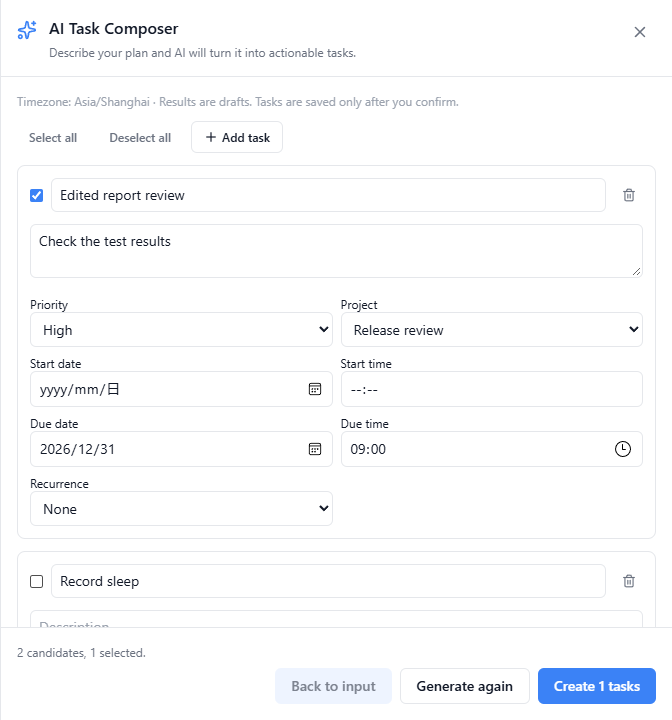
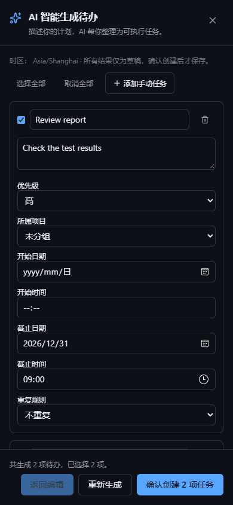

# AI Task Composer P0：审计与验收

日期：2026-10-13。目标分支：`release/v1.5.2`，初始审计基线 `ac787f3224ce58d1049bbb0eee658ed290de9be2`；交付前同步的目标基线 `56abe96afdfe59fdcc8f4c4e590b727cd56a2604`。功能分支：`codex/ai-task-composer-v1.5.2`。在独立工作树开发，原 checkout 的锁文件修改与三个未跟踪结果文件未纳入提交。

## 源码审计

| 模块 | 当前能力与本次选择 |
| --- | --- |
| `TaskCenterImpl.tsx` / `api.impl.ts` / `types/index.ts` | 已有任务 CRUD、项目、日期、提醒、重复和批量完成/删除。增加懒加载助手入口与创建后刷新，不另建任务中心。 |
| `AIChatPanel.tsx` / `taskDigestApi.ts` | 已有个人任务创建/完成的明确确认、早晚摘要。保持原路径，不自动修改已有任务。 |
| `TaskAIBreakdown.tsx` / `tasks.ts` | 已有 AI 子任务拆解与逐项确认创建；没有自然语言批量可编辑预览、整批事务和持久化幂等。 |
| `MyDayPanel.tsx` / `taskDayPlanApi.ts` / `task-day-plans.ts` | 已有每日计划和重点任务；P0 的重点数量仅指导优先级，不写入 My Day。 |
| `TaskInboxPanel.tsx` / `TaskQuickCaptureBridge.tsx` | 已有收集箱及快速捕获；不重复建设。 |
| AI Provider / 用户设置 | 复用 `getUserAISettings`、`isManualAIEnabled`、`callAIChat`；只发送当前输入、时区/日历锚点和用户选择的项目 ID。 |
| 认证 / ACL / PAT | 挂在现有 JWT 路由之后，复用工作区成员与 feature gate；PAT 保持原有权限范围，不能调用助手或批量写入。 |
| `ApplicationCommandGateway` / `packages/nowen-mcp/src/index.ts` | 已有统一业务路由及个人任务工具。保持原工具和确认机制，无新自动写入工具。 |
| 数据库 / Sync V2 | 已有任务活动、Change Feed 和 Outbox 触发器；发现任务载荷遗漏描述、精确时间、开始日期、项目与重复字段。本次补齐可选字段并兼容旧载荷。 |
| Native / Web 离线 | Web 已有任务队列；Native 任务列表读 SQLite，重复字段未持久化。P0 确认只走在线 API；Native 缓存已确认任务/服务器项目，保留已有编辑与 Outbox。 |
| i18n / 自动化 | 复用中英资源合并、主题颜色和业务事件。每项 task.created 事件与整批任务、幂等记录同事务保存。 |

这是新功能，故障根因不适用。已确认的架构缺口是批量草稿流程、事务幂等和任务同步字段保真。

## 实现和数据边界

- `POST /api/ai/task-plan/preview?workspaceId=...`：文本最多 12,000 字符，请求最多 64,000 字节；默认 12、硬上限 30 个候选。Zod 严格校验，拒绝伪造归属、无效项目、日期、重复规则与异常字段。不会写任务或自动化事件，也不向模型发送现有任务/私人笔记。去重查询只在当前已授权空间执行。
- `POST /api/tasks/ai-batch-create?workspaceId=...`：请求最多 256,000 字节。与普通创建共用原业务函数；整批验证后在 SQLite IMMEDIATE 事务中写任务、触发活动/同步记录、发布逐项业务事件、写幂等台账。任一失败回滚整批。
- 幂等性按用户、空间、requestId 与 previewId 隔离，并绑定最终内容的 SHA-256。相同批次重试返回原 ID；同 ID 不同内容返回 409；不同请求 ID 的相同未完成任务在事务内再次去重。疑似重复需要每项明确 `allowDuplicate`。
- 客户端保存按服务器/账号/空间隔离的 session 草稿。响应不确定时冻结最终 payload，重试相同 ID；确认成功后才刷新列表、统计和提醒状态。失败不显示全部成功；创建成功但本机缓存失败单独提示。
- 日期仅接受有效日历键；精确时间采用现有 `YYYY-MM-DDTHH:mm` 本地时间语义，拒绝 Z/offset 与矛盾日期。当前日期、明天、后天和下周一按用户 IANA 时区构造。DST 缺失时间拒绝，重复时间提示人工确认。
- Native schema 7/8→9 在迁移事务中添加重复字段，不清理队列；已确认任务 `INSERT OR IGNORE`，重试不覆盖本机编辑。服务器项目使用现有 Native 项目表。重复任务完成/撤销在线复用普通任务 API，并缓存下一次任务；有未同步本机编辑或离线时拒绝修改并提示。普通 Native 离线任务仍走原路径。
- 不新增大型依赖、私人笔记上下文或离线写入队列。P1/P2（笔记提取、已有任务规划、My Day 写入、自动规划）未实现。

## 实际验证

所有数据库和账号均为隔离模拟数据。后端使用项目 Electron Node runtime（本机 better-sqlite3 是 Electron ABI）；前端 Native SQLite 用例使用 Node 24 内置 SQLite。构建仍用项目原脚本。

| 检查 | 实际结果 |
| --- | --- |
| 后端 TypeScript / `npm run build` | 通过。 |
| 前端 TypeScript / `npm run build` | 通过，保留既有 Browserslist、chunk 大小与动态/静态混用提示。 |
| 任务、权限及相关后端回归 | 29 个文件 / 216 项通过，含预览隔离、异常模型、日期/DST、跨空间、事务回滚、重复点击/重启/并发、重放归属重验、普通 CRUD、拆解、My Day、收集箱和提醒。 |
| 前端任务、i18n 和 Native 回归 | 42 文件 / 374 项通过；包括可编辑草稿、取消、迟到响应、选中项、重复确认、离线/错误、账号切换、Native 迁移/缓存/重复任务完成。 |
| Lint | 新文件定向 ESLint 通过；基线门禁 0 个新增错误（项目已有 1,446 项历史错误）。 |
| DCC 映射 | 12 个不变量、121 个测试引用校验通过。新增 DCC-002、DCC-006 的任务与身份测试映射。 |
| DCC 前端真实回归 | 23 文件 / 201 项通过。 |
| DCC 后端扩展回归 | 矩阵 11/12 文件共 175 项通过，包含多设备 SQLite/真实 Sync V2 API 的 52 项。`note-delete-attachments.test.ts` 在当前分支与未修改基线均超时；因此不宣称全套 DCC 后端通过。原脚本还出现过组合运行超时，独立多设备运行已通过。 |
| Web 浏览器 | Edge 实际生产路由、真实注册/登录、测试 AI HTTP 服务；桌面英文亮色与 390×844 中文暗色流程通过，预览无写入、编辑/项目/时间落库、列表刷新、重复规则、离线和非法 JSON 通过，未见横向溢出。 |
| Windows Electron renderer | 同一真实任务中心与测试服务，预览时库为空，确认后整批落库通过。使用隔离且隐藏的 Electron 测试窗口；不是安装包验收。 |

复测入口（后端文件需串行且隔离 DB）：

```powershell
# 依赖须与所选 Node/Electron ABI 一致
node scripts/data-consistency-contract.mjs --verify
cd backend
npx tsc --noEmit -p tsconfig.json
npm run build
# 在匹配 ABI 的 Node 下：
node --import tsx --import ./tests/setup-db-isolation.ts --test tests/task-composer.test.ts
node --import tsx --import ./tests/setup-db-isolation.ts --test tests/task-composer-dates.test.ts
cd ../frontend
npm run build
npm run lint:baseline
npx vitest run src/components/tasks/__tests__/TaskComposer.test.tsx src/lib/__tests__/taskComposerApi.test.ts src/lib/__tests__/nativeTreeSchemaMigration.test.ts
$env:PLAYWRIGHT_CHANNEL='msedge' # 或安装 Playwright 的 Chromium 并不设置此项
npx playwright test --config playwright.task-composer.config.ts
```

界面截图：





## 未验证和发布边界

真实远端模型的语义质量、费用和特定 Provider 兼容性未验证；自动化通过测试 Provider 返回结构化输出，不能替代真实模型试用。Android/iOS 真机、macOS、HarmonyOS、安装包、Docker、生产数据、多设备真实网络与通知投递未验收。跨设备的绝对时刻仍受现有任务“本地 wall time”契约限制，没有新增每任务时区字段。

新端兼容旧 payload 缺失的可选字段；旧客户端自身不能展示其不认识的重复字段，需升级。Native 重复任务完成需要在线及已同步状态，明确失败时保留任务。新迁移只增加幂等表与 Native 重复字段，不删除用户数据。

回滚功能时应先移除助手入口/新增端点，保留 schema 125 / Native schema 9 的兼容迁移和已有任务，不能直接删任务、台账或 Outbox。回退不认识新 schema 的旧二进制前，需按既有备份流程做快照并验证恢复方案；本任务未执行生产降级/恢复。

2026-10-14：用户要求解决冲突后合入 `release/v1.5.2`。集成时保留任务归档迁移 124，将 Composer 迁移调整为 125，Native schema 调整为 9，补齐归档与重复字段的组合升级和同步回归。此合并授权不代表上述未完成平台验收或发布门禁已经通过。

本次集成验证：后端 31 文件 / 273 项、前端 43 文件 / 370 项回归通过，前后端类型检查和生产构建通过，DCC 12 个不变量 / 125 个测试引用校验通过。其中 55 项真实 Native 多库同步回归覆盖归档与重复字段组合。修正新增导入链触发的 3 处 i18n 测试 Mock，并为 Native 多库测试适配真实重复字段 schema。原 P0 验证记录仍保留其平台和验收边界。

## English delivery boundary

P0 implements natural-language task drafts, editable selection, validated atomic confirmation, durable idempotency, scoped duplicate checks, local-calendar validation and the existing task event/sync paths. Native confirmed-task/project caching preserves pending edits; recurrence completion uses the canonical online endpoint. Tests use isolated data and a deterministic AI provider. Browser and Windows Electron renderer checks are development evidence, not packaged-device or production acceptance. The existing note-deletion test also times out on the untouched target baseline, so full backend DCC success is not claimed. On 2026-10-14 the user authorized conflict resolution and integration into release/v1.5.2; this does not waive the outstanding platform and release acceptance boundaries.

## 修改文件

- `CHANGELOG.md`
- `backend/src/automation/eventCapture.ts`
- `backend/src/db/migrations.ts`
- `backend/src/db/syncPersonalEntitiesMigration.ts`
- `backend/src/db/taskComposerMigration.ts`
- `backend/src/index.ts`
- `backend/src/middleware/api-token-resource-scope.ts`
- `backend/src/routes/ai-task-plan.ts`
- `backend/src/routes/tasks.ts`
- `backend/src/services/ai-client.ts`
- `backend/src/services/task-composer.ts`
- `backend/src/sync/apply.ts`
- `backend/src/sync/applyLocal.ts`
- `backend/src/sync/bootstrap.ts`
- `backend/src/sync/taskFields.ts`
- `backend/tests/sync-v2-personal-entities.test.ts`
- `backend/tests/task-composer-browser-server.ts`
- `backend/tests/task-composer-dates.test.ts`
- `backend/tests/task-composer.test.ts`
- `docs/architecture/data-consistency-contract.matrix.json`
- `docs/qa/ai-task-composer-p0.md`
- `docs/qa/artifacts/task-composer/.gitignore`
- `docs/qa/artifacts/task-composer/desktop-light-en.png`
- `docs/qa/artifacts/task-composer/mobile-dark-zh.png`
- `docs/tutorials/tasks.md`
- `frontend/e2e/fixtures/task-composer-electron.cjs`
- `frontend/e2e/task-composer.spec.ts`
- `frontend/playwright.task-composer.config.ts`
- `frontend/src/components/TaskCenterImpl.tsx`
- `frontend/src/components/tasks/TaskComposer.tsx`
- `frontend/src/components/tasks/__tests__/TaskComposer.test.tsx`
- `frontend/src/i18n/__tests__/releaseI18nCoverage.test.ts`
- `frontend/src/i18n/index.ts`
- `frontend/src/i18n/taskComposerTranslations.ts`
- `frontend/src/lib/__tests__/nativeTreeSchemaMigration.test.ts`
- `frontend/src/lib/__tests__/taskComposerApi.test.ts`
- `frontend/src/lib/encryptedNotes/__tests__/nativeDatabaseInitialization.test.ts`
- `frontend/src/lib/mobileLocalAdvancedTaskBridge.ts`
- `frontend/src/lib/mobileLocalModuleBridge.ts`
- `frontend/src/lib/mobileSyncEngine.ts`
- `frontend/src/lib/nativeDatabase.ts`
- `frontend/src/lib/nativeTaskComposerCache.ts`
- `frontend/src/lib/nativeTaskFields.ts`
- `frontend/src/lib/taskComposerApi.ts`
