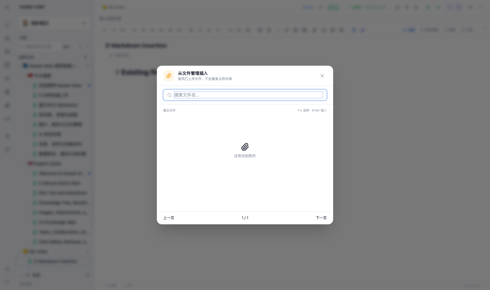
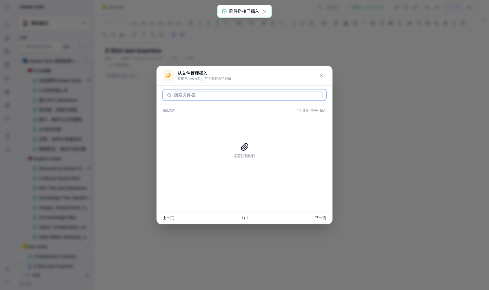
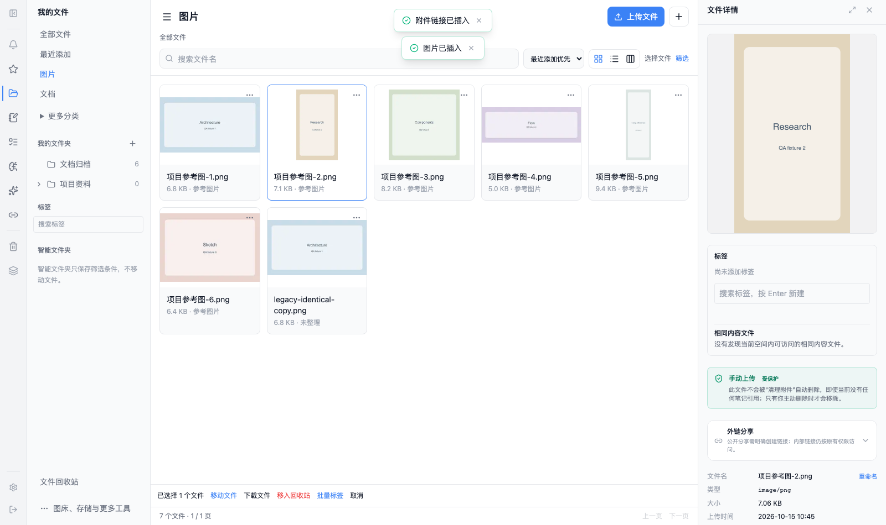
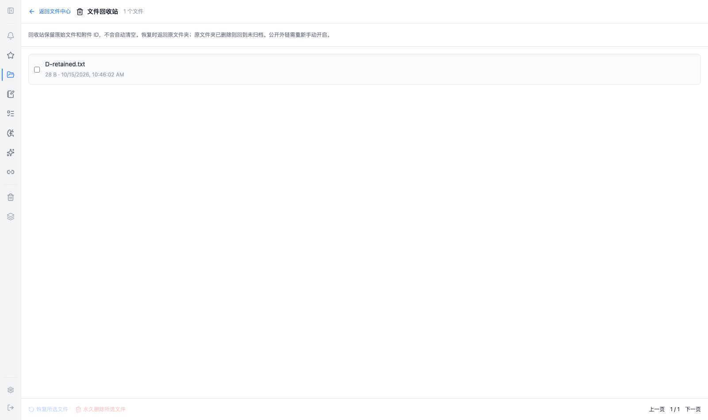
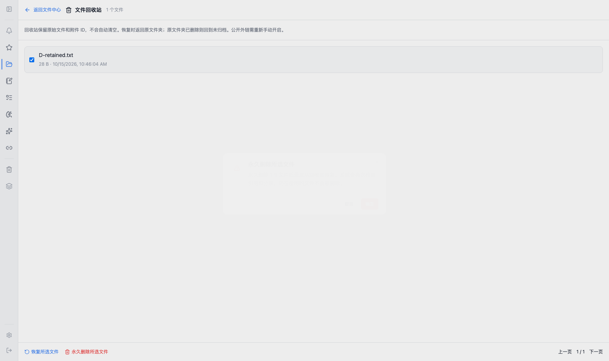
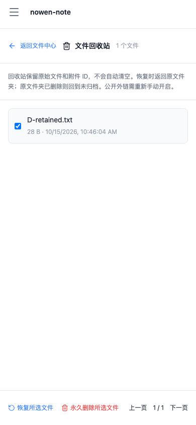
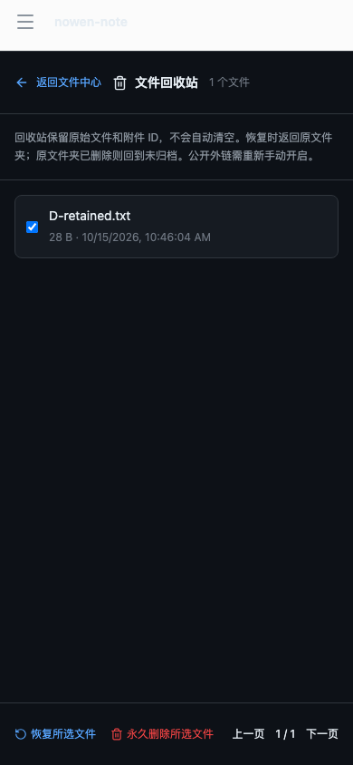
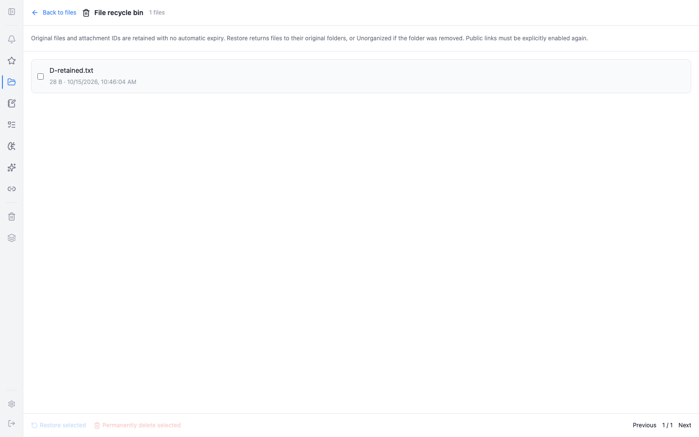

# Phase D2 — file recycle bin

Depends on D1, `codex/files-assets-center-v2-linking`; base release is `e5c6e4ef`.
This module is independently reviewed and is not a release or completion of all Phase D requirements.

## Behavior and boundaries

- Existing single/batch file deletion and the attachment management delete endpoint now move unused files to the recycle bin. Existing note/reference/share safety checks remain authoritative. Referenced files, including trashed-note references and active shares, are refused.
- Original IDs, binary paths, bytes, hashes and tag relationships remain. Active explorer lists, counts, folders, identical-file results and note insertion exclude trashed files. Upload deduplication never revives a trashed record.
- Restore returns to the original personal folder; a missing folder safely falls back to Unorganized. Whole restore/purge batches are validated before any writes.
- Purge accepts only a trashed file with an explicit `PERMANENTLY_DELETE` confirmation. Current management permission, references and shares are checked again inside the transaction. Shared physical paths are retained. Storage cleanup failure is reported as `cleanupPending`; it is not reported as complete object removal.
- Public file policies are disabled on trash and stay disabled after restoration. Private authorized attachment reads can continue; this is not secure erasure or revocation of previously downloaded copies.
- No scheduled expiry. Existing orphan cleanup refuses trash entries. A DB retention trigger prevents accidental cascading deletion. Note deletion helpers check the entire cohort before unlinking any object; users must first restore or purge retained file entries before permanently deleting their source note.
- Native recycle-bin writes fail explicitly before SQL deletion or HTTP fallback. Native folder/organization synchronization is a separate D3 module; no unsupported operation claims offline success.

## Persistence and rollback

SQLite additive migration **v128** adds `trashedAt`, `trashedBy`, `originalFolderId`, an index and a retention trigger. Existing attachments start active. It is idempotent and rewrites no original binary.
Matching PostgreSQL migration is provided; executed twice in isolated PostgreSQL/WASM, including rejection of implicit deletion and success of explicit purge. This does not certify production PostgreSQL runtime support.

Back up the database and all managed attachments before upgrading. Restore the matching database plus binary snapshot to roll back; do not run an old binary against the upgraded schema. Full database snapshots include retained metadata, and managed binary layout is unchanged.

## Executed checks

- New recycle-bin backend: **6 passed** (identity/bytes/tags, restore/fallback and atomicity, explicit purge/ref checks, dedup isolation, idempotent migration, GC scan/dry-run/live retention).
- Linking plus Yjs durability/subdocuments: **13 passed**; reference repository: **11 passed**. File sharing/cache/note-deletion/recycle-bin regressions: **34 passed** before the final GC case; GC/orphan compatibility: **4 passed**.
- Complete backend DCC: **16 files / 230 passed**, no failures or skipped tests, using isolated temporary data.
- Targeted frontend: **5 suites / 19 passed**, covering picker/snippets, trash UI, explorer confirmation scope and Native refusal; i18n release coverage **24 passed**.
- Backend/frontend TypeScript, backend bundle, changed explorer/trash ESLint and frontend production build passed. Existing frontend bundle warnings remain.
- Production frontend + full backend Chromium: both editor insertions persist and update authorized references; no copied asset; reference navigation; trash list, restore original ID/folder/bytes; purge confirmation/cancel; mobile and dark layouts.
- Eight actual application screenshots in `screenshots/phase-d/`. No static mock is used as acceptance evidence.

Full frontend DCC: **221 passed / 3 existing schema-v9/v10 assertion failures / no skips**. Repository lint baseline and bundle budgets remain separate existing failures. Installed Electron, Android, production S3/PostgreSQL and physical network recovery have not been accepted.

## UI evidence

