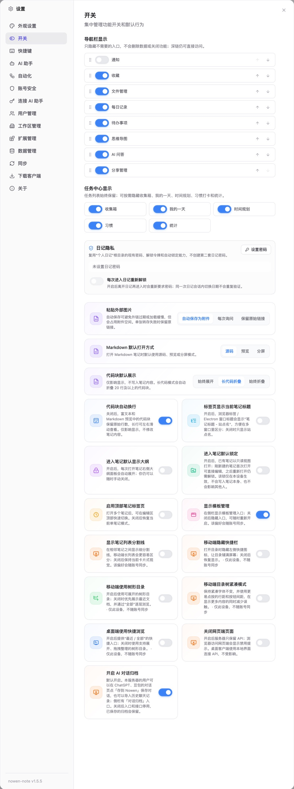
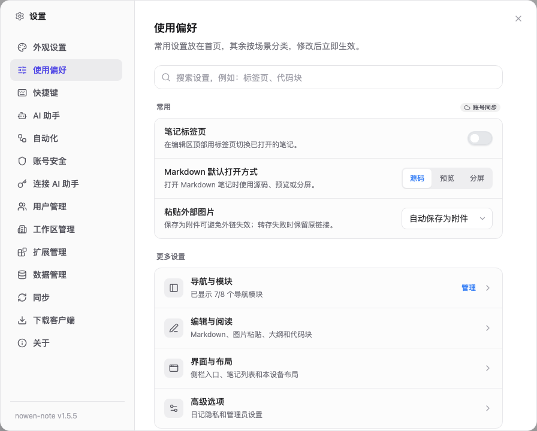
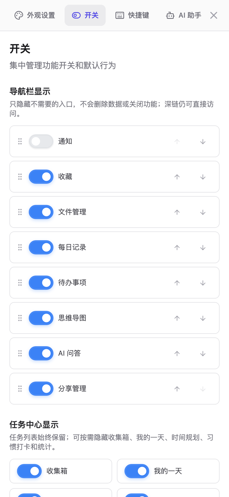
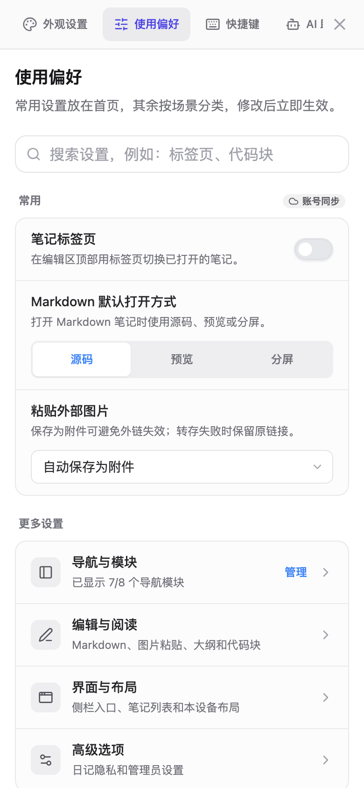

# 设置「开关」→「使用偏好」改造（v1.6.0）

基线：`release/v1.6.0` @ 0ffd1f9c0。截图来自一次性测试服务（Chromium 无头，zh-CN）：桌面 1440×900，移动 390×844。

## 信息架构

- **首页**：设置搜索 + 「常用」3 项（笔记标签页、Markdown 默认打开方式、粘贴外部图片）+ 「更多设置」4 个分类入口。
- **导航与模块**：导航模块的显示/隐藏与排序（拖拽或上下箭头）；任务中心模块默认折叠。首页只显示「已显示 x/8 个导航模块 · 管理」。
- **编辑与阅读**：高频 4 项直接显示，代码块与笔记锁定 3 项收在「更多选项」里。
- **界面与布局**：「通用」3 项随账号同步；「此设备」只显示当前布局（窄于 768px 为手机布局，否则为桌面布局，与 App 的布局断点一致）适用的选项。
- **高级选项**：列出已移到其他页签的设置，按权限显示，选择后切到对应页签并定位、高亮到该项。
- 左侧一级导航只是「开关」改名为「使用偏好」，没有新增分类。

## 新旧位置映射（20 项，无删除）

| # | 旧位置（开关页，自上而下） | 新位置 | 存储 / 作用域（均未改） |
|---|---|---|---|
| 1 | 导航栏显示（8 个模块的显示/隐藏、拖拽、上下移） | 使用偏好 → 导航与模块 → 导航模块（首页显示数量与「管理」） | `hiddenNavigationModules`、`navigationModuleOrder`，账号同步 |
| 2 | 任务中心显示（5 个可选模块） | 使用偏好 → 导航与模块 → 任务中心模块（折叠） | `hiddenTaskCenterModules`，账号同步 |
| 3 | 日记隐私（设置/管理密码、每次进入日记重新解锁） | 账号安全 → 「密码文件夹自动锁定」之后 | 服务端 `/journals/privacy*` + `journalLockOnEntry`，账号同步 |
| 4 | 粘贴外部图片 | 使用偏好首页「常用」；编辑与阅读 | `remoteImagePasteMode`，账号同步 |
| 5 | Markdown 默认打开方式 | 使用偏好首页「常用」；编辑与阅读 | `markdownDefaultViewMode`，账号同步 |
| 6 | 代码块默认展示 | 编辑与阅读 → 更多选项 | `codeBlockCollapseMode`，账号同步 |
| 7 | 代码块自动换行 | 编辑与阅读 → 更多选项 | `codeBlockWordWrap`，账号同步 |
| 8 | 标签页显示当前笔记标题 | 界面与布局 → 通用（「窗口标题显示笔记名」） | `noteTitleAsAppTitle`，账号同步 |
| 9 | 进入笔记默认显示大纲 | 编辑与阅读（「默认显示大纲」） | `outlineDefaultOpen`，账号同步 |
| 10 | 进入笔记默认锁定 | 编辑与阅读 → 更多选项（「打开笔记时锁定」） | `lockOnOpen`，账号同步 |
| 11 | 启用顶部笔记标签页 | 使用偏好首页「常用」；编辑与阅读（「笔记标签页」） | `enableNoteTabs`，账号同步 |
| 12 | 显示模板管理 | 界面与布局 → 通用（「模板管理入口」） | `showTemplateManagement`，账号同步 |
| 13 | 显示笔记列表分割线 | 界面与布局 → 通用 | `showNoteListDividers`，账号同步 |
| 14 | 移动端隐藏快捷栏 | 界面与布局 → 此设备 · 手机布局 | `nowen-mobile-rail-hidden`，仅本设备 |
| 15 | 移动端使用树形目录 | 界面与布局 → 此设备 · 手机布局 | `nowen.mobileKnowledgeTree.viewMode.v1`，仅本设备 |
| 16 | 移动端目录树紧凑模式 | 界面与布局 → 此设备 · 手机布局 | `nowen.mobileKnowledgeTree.compact.v1`，仅本设备 |
| 17 | 桌面端使用快捷浏览 | 界面与布局 → 此设备 · 桌面布局 | `nowen.desktopKnowledgeTree.viewMode.v1`，仅本设备 |
| 18 | 隐藏桌面端菜单栏（Windows/Linux 桌面端） | 界面与布局 → 此设备 | Electron 主进程设置 `hideMenuBar`，仅本设备 |
| 19 | 关闭网页端页面（管理员） | 用户管理 → 「允许公开注册」下方 | 站点设置 `web_ui_enabled`，管理员 |
| 20 | 开启 AI 对话归档（管理员，仅此设备模式除外） | AI 助手 → 「手动 AI 配置」下方 | 站点设置 `feature_ai_memory_enabled`，管理员 |

第 3、19、20 项同时出现在「使用偏好 → 高级选项」和搜索结果里，作为前往入口。

## 行为说明

- 存储键、默认值、同步协议、后端 API 和权限判断都没有改；新界面调用的是同一个 `setPref` / 站点设置接口。
- 账号偏好仍是本地优先：先写入账号隔离缓存，再后台同步，网络失败时保留待同步、不回滚（与原行为一致）。页面不会显示「已同步」。
- 服务端设置（第 19、20 项）和桌面菜单栏（第 18 项）先切换，失败时恢复原值并提示原因；原来失败时没有提示，菜单栏返回 `ok: false` 时也不会恢复。
- 只在当前布局下显示适用的设备选项：桌面宽度不显示手机布局选项，反之亦然；窗口尺寸变化时随之切换。隐藏菜单栏只在 Windows/Linux 桌面端显示。
- 「账号同步」「仅本设备」「管理员」用标签区分。仅此设备模式下账号偏好也只保存在本机，标签显示为「仅本设备」；Android 未开启同步时页面给出说明。
- 日记隐私在仅此设备模式下原本就无法使用（远程请求被拒绝），现在随「账号安全」一起不在该模式下显示。
- 搜索覆盖全部设置、8 个导航模块、5 个任务中心模块和已移走的 3 项；支持方向键与 Enter，Esc 清空。中文可按顺序输入部分字，例如「代码换行」可以找到「代码块自动换行」。
- 跳到其他页签时会等目标渲染完成再滚动、高亮并聚焦；手机上顶部页签栏会滚到当前页签。
- AI 助手页签在构建时由 `AISettingsReliabilityShell` 承载（`vite.config.ts` 别名），对话归档开关放在它的「手动 AI 配置」下方：不随手动 AI 关闭而变暗，也不会被下方异步加载的配置挤走位置。

## 截图

| 改造前 | 改造后 |
|---|---|
|  |  |
|  |  |

- 桌面：[搜索后定位](desktop-search-jump.png) · [导航与模块](desktop-navigation.png) · [界面与布局](desktop-layout.png) · [高级选项](desktop-advanced.png) · [AI 助手中的对话归档](desktop-ai-archive.png) · [账号安全中的日记隐私](desktop-security-journal.png) · [用户管理中的网页端访问](desktop-users-web-ui.png) · [深色首页](desktop-dark-home.png)
- 移动：[界面与布局（手机布局）](mobile-layout.png) · [搜索已移走的设置](mobile-search.png) · [从搜索跳到用户管理](mobile-jump-users.png) · [深色编辑与阅读](mobile-dark-editing.png)

## 验证记录（2026-11-18）

- `tsc -p tsconfig.app.json --noEmit`：0 错误。
- 前端全量 vitest（`TZ=Asia/Shanghai`）：795 个文件 / 4832 个用例全部通过。
- `npx vite build`：通过。
- E2E：`ai-memory-switch.spec.ts`（从使用偏好搜索跳到 AI 助手关闭，再直接在 AI 助手开启）通过；`markdown-slash-menu.spec.ts` 的代码块换行用例 1440px、390px 均通过。
- `node scripts/data-consistency-contract.mjs --verify`：通过。
- 后端 `ai-memory*.test.ts` 通过；`mcp-ai-archive.test.ts` 在未改动的基线上同样失败（409，内嵌 MCP 依赖未构建的 `packages/nowen-mcp`），与本改动无关。
- `npm run lint:baseline`：新增文件无错误；报告的 16 处均为基线已有代码。
