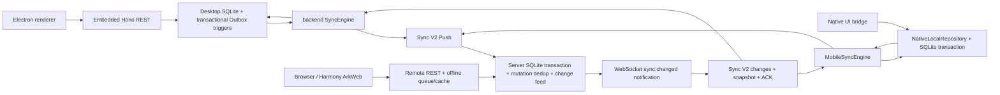

# Sync V2 reliability audit / 多端同步可靠性审计

审计日期：2026-10-11。基准：`release/v1.5.2`，`d95d3787`。本文区分源码能力、自动化验证和设备验收；目标延迟不是实测结果。

## Phase 0：真实架构和平台路径

| 平台 | 实际业务保存 | 同步路径与边界 |
| --- | --- | --- |
| Windows/macOS/Linux Electron | 内嵌 Hono → SQLite；触发器捕获 Outbox | `backend/src/sync/engine.ts`，Push/Pull/冲突/附件；各操作系统包没有在本次审计中验收 |
| Web，包括手机浏览器 | 在线 REST 写服务器；失败后 `offlineQueue.ts` + `localStore.ts` | **Remote-first**，`syncEngine.ts`/`offlineRead.ts` 是缓存和离线回放，不是 Native Sync V2；缓存与队列尚不是单个 IndexedDB 业务事务 |
| Android | `mobileLocalFirstBridge.ts` → `nativeLocalRepository.ts` → `nativeDatabase.ts` | 笔记与 Outbox 在同个 SQLite 事务；`mobileSyncEngine.ts` 使用十类旧协议实体；登录态知识树为服务端优先，正文为本地优先 |
| iOS | `configureRuntime()` 使用 `Capacitor.isNativePlatform()`，所以共用 Native 初始化代码 | 存在 Xcode/Capacitor 工程；但多个 UI/runtime 分支只检查 Android，不能据此宣称 iOS 等价；Windows 无 iOS 构建/设备证据 |
| HarmonyOS | ArkTS/ArkWeb + `nowen-harmony/entry/src/main/ets/bridge/JsBridge.ets` | 没有检索到共用 Native SQLite Sync V2 的桥接实现；不能宣称离线强杀等价于 Android |

既有并行链路：Sync V2、Web IndexedDB/REST 离线队列、旧 `/offline-sync` feed、Yjs 文档协作、Electron 文件夹同步。Android 的 `OfflineSyncRuntime` 已明确不挂载旧 Web 队列 runtime，但知识树/正文仍跨两种权威数据源。Yjs 是打开文档的协作能力，不是完整设备持久化协议；本次不引入第三套同步协议。

## 功能与实体覆盖矩阵（源码证据）

“实现”不代表跨平台生产验收已完成。

| 能力/实体 | Desktop V2 | Android V2 | Web | 证据/缺口 |
| --- | --- | --- | --- | --- |
| Markdown/富文本笔记、标题、常用元数据 | 实现 | 实现 | REST + cache/queue | `apply.ts`/`applyLocal.ts`/`mobileSyncEngine.ts`；正文按完整文档版本处理，不拼接富文本 JSON |
| 笔记本、标签、note_tag、收藏 | 实现 | 实现 | REST | 部分实体没有正文级版本冲突协议，不能承诺任意并发字段修改都可恢复 |
| knowledge_tree_node、结构和排序 | 协商能力，已有 baseline/readiness/冲突路径 | **未接入**移动 V2 实体注册表；登录树走服务器 | `types.ts` 额外协商树实体；`isCoreEntityType()` 只有十类；Native 纯设备树为投影 |
| 任务、task_reminder、日记、思维导图 | 实现 | 实现 | REST 与既有模块离线适配 | 高级任务项目/模板/依赖和附件文件夹不在十类实体集合 |
| 附件元数据和二进制 | 分开追踪 | 分开追踪 | 缓存/恢复路径 | `blob.ts`/`sync-v2-blob.ts`/`transferAttachments()`；笔记正文 ACK 不等于附件成功 |
| 回收站/恢复/永久删除 | 已有路径 | 已有路径，但删除保护存在 P0 缺口 | REST + cache | 历史清理后的 tombstone/reset 和父实体级联仍需加强回归 |
| 加密笔记 | 密文 guard | 密文 guard | 密文 REST + client decrypt | `encrypted-notes-sync.test.ts`、`noteDocument.ts`；不得把正文/密钥写日志 |
| workspace、权限撤销 | scope/fingerprint/冻结 | scope/fingerprint/冻结 | REST ACL | 必须保留跨用户/撤权负例；离线密码目录另有访问 guard |
| 本地保存与 Outbox 原子性 | SQLite 触发器事务 | SQLite transaction | **未完成统一原子链路** | 浏览器不能被描述为完整 Local-first |
| 持久化 mutationId、重复 Push | 实现 | 实现 | REST 回放并非所有入口都有稳定 mutationId | `sync_applied_mutations`；重试不得换 mutation 身份 |
| 逐笔记 ACK 收据 | 本机 REST 不当云端确认，查询不完整 | PR #821 mutation ACK | 本次修订 + 有效正文版本 ACK | 没有可靠另一设备收据，不能称所有设备已同步 |
| 通知/重连/周期 Pull | backend realtime + engine timer | 缺少 runtime `sync.changed` → Pull 接线与稳定周期补偿 | 既有 realtime + REST refresh | 前台通知性能尚无 P50/P95/P99 |
| 冲突查看/保留两端/另存为 | 已有设置 UI/冲突记录 | 已有 admin adapter/冲突记录 | queue/draft/conflict store | 删除冲突和解决后的版本基线需专项回归 |

## P0/P1/P2 问题清单

| 级别 | 代码证据与影响 | 当前复现状态/后续验证 |
| --- | --- | --- |
| P0 | Native Push ACK 仅保存 receipt/删除队列，未校准 `notes.version` 和后续队列 `baseVersion`；桌面 `acknowledgeNotePush()` 已做校准 | 需独立 SQLite/真实 API 回归确认连续编辑及 ACK 延迟，避免自身假冲突 |
| P0 | Native `applyEntries()` 的 pending/conflict 判断排除了 `__delete`；删除可直接覆盖本地尚未上传正文 | 需失败用例证明本地正文/Outbox/双方冲突在远端删除后仍可恢复 |
| P0 | Native `request()` 在响应 JSON 异步解析后没有再次校验停止/登录身份；旧会话响应可能继续 Apply | 需延迟 JSON、切账号/stop 回归，旧 DB 不允许接受迟到数据 |
| P0 | Native ACK 收据允许 mutationId 存在但 version 非法仍显示 confirmed | 需非法/缺失版本用例；无证据应为 unverified |
| P1 | 登录态树创建与正文数据库不同，旧版可见树节点但读本地不存在 | #829 原文无日志；当前基准已有授权远端 fallback 和回归，不能宣称复现或真机已解决；fallback 仍非离线本地可读 |
| P1 | Native runtime 没有订阅 `sync.changed`、没有普遍周期 Pull；收到事件与 UI 刷新也需以本地 Apply 为界 | 需接线测试、通知丢失/重连及实际延迟测量 |
| P1 | pull 的同实体多次 upsert/delete 未按最终 feed 操作折叠；snapshot 可能缺失已删除实体而一直报错 | 需 create→delete 同页、delete→recreate 同页回归；snapshot 与 feed 竞态需明确协议边界 |
| P1 | Snapshot pruning 使用父实体删除/附件物理删除，保护仅检查该实体的 Outbox | 需父子依赖、冲突、附件队列保留检查，不能通过删库修复 |
| P1 | 冲突解决 Native keep-local 仍使用本地 payload 版本，服务端版本更高时后续编辑可能重新冲突 | 需双方保留/版本收敛/删除恢复测试 |
| P2 | 文档 `sync-realtime.md` 主要描述旧 Web cache/full-snapshot 路径 | 需更新平台边界与当前 V2 行为 |

Android“Web 修改后闪退”尚未取得本次复现/新崩溃日志，不能用 TypeScript 异常处理替代原生诊断。既有 Kotlin Filesystem 包装修复和 Native list 预览限长在基准中；本次必须检查 logcat 和隔离包运行证据。

## 测试缺口与安全策略

已有大量单元/路由测试，但 `sync-v2-engine.test.ts` 使用可编程 FakeRemote；不能替代三个独立客户端数据库与一个真实服务端数据库。新增测试应使用真实路由、独立文件和持久化重开，覆盖双向/三端、并发、ACK 后崩溃、Apply 失败、删除、非法 ACK、旧会话回调和权限拒绝。故障日志只保留错误码/耗时/计数，不输出正文、Token 或密钥。

禁止清库/清 Outbox 解决普通故障。先在测试库证明原子回滚和重启恢复，再修改业务代码；不需要数据迁移的修复保持 schema 不变。涉及设备验收使用独立包与测试账号，不触碰现有用户笔记。Docker、NAS、macOS/Linux 包、iOS 和 HarmonyOS 没有真实执行证据时均列为未验收。

实施顺序与成功标准：

1. Phase 0 审计并保留证据 → 本文可追溯到实际调用链、Issue #829 和 PR #821。
2. Phase 1 先写失败测试再修 P0 → 本地正文/队列不丢、ACK 仅确认发送的版本、旧会话不能 Apply、双方冲突可恢复。
3. Phase 2 接通知、周期补偿与 UI → 通知只唤醒 Pull，Apply 后刷新，无回声循环，记录实测延迟。
4. Phase 3 回归与交付 → 独立提交、目标构建/lint/设备证据、PR 指向 `release/v1.5.2`，剩余项明示；不发布正式版本。
